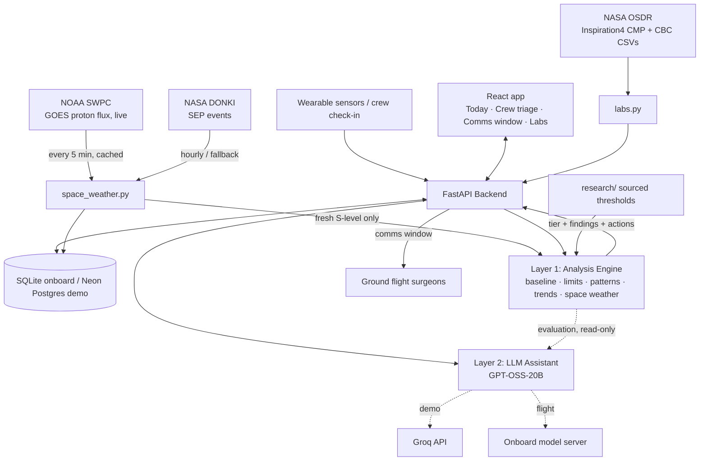

# System Architecture - AstroGuardian-AI

AstroGuardian-AI is a modular system: a deterministic analysis engine decides alert tiers, a FastAPI backend stores data and enforces roles, a React frontend gives each role its own home screen, and an LLM explains results without ever changing them. Real space data comes in from NOAA, NASA DONKI and NASA OSDR, alongside simulated crew vitals.

## System Workflow Diagram

## Data sources

| Source | Module | How it's fetched | If it fails |
|---|---|---|---|
| Simulated crew telemetry, calibrated to Barger 2014 (sleep) and DOSIS 3D (radiation) | `data/generate_sample_data.py` → `db.py` | Seeded into the database | — |
| NOAA SWPC GOES ≥10/≥100 MeV proton flux | `backend/space_weather.py` | `httpx`, 4 s timeout, at most every 5 min, cached in the `meta` table | Last good reading reused (`source: cache`) |
| NASA DONKI SEP events (30 days) | `backend/space_weather.py` | Hourly (the free key allows ~30 requests/hour), or immediately if NOAA is down | UI says "event log unavailable"; no effect on alert tiers |
| NASA OSDR OSD-575 (CMP) + OSD-569 (CBC), Inspiration4 | `backend/labs.py` | Bundled CSVs in `data/osdr/`, loaded once | — (works offline) |

## Data flow for one reading

1. A reading arrives (`POST /api/astronauts/{id}/readings`) and is stored in the database.
2. `ai.health_monitor.evaluate()` loads the astronaut's history. The "current state" is the latest value of each metric, with sensor values carried forward for up to 12 h, so a self-report-only check-in isn't read as a sensor dropout. It builds a personal baseline from the **previous** readings only.
3. `detect_risk()` runs, in order:
   - absolute limits;
   - live space weather (NOAA S3 → YELLOW, S4+ → RED, only if measured within the last 2 h);
   - multi-day patterns;
   - persistent personal-baseline deviations;
   - 3-day trend projection;
   - missing and stale data checks.
4. The highest severity among the findings becomes the tier (GREEN < UNKNOWN < YELLOW < RED).
5. `get_recommendations()` attaches concrete actions **to each finding**, plus a de-duplicated list.
6. `backend/service.record_evaluation()` keeps **one open alert per astronaut**:
   - a repeat of the same problem bumps its counter;
   - a new metric or a higher tier closes it as *superseded* and opens a new one;
   - GREEN resolves it.
7. Only on request, the LLM receives the finished evaluation and explains it. It cannot write to the database or alter the tier.

## API

All routes except `/api/health` and `/api/auth/*` need a session (password gate plus chosen role). See the permissions table in the README.

| Method | Path | Purpose |
|---|---|---|
| POST | `/api/auth/unlock` | Check the access password |
| POST | `/api/auth/role` | Choose astronaut (with id), cmo or ground |
| GET | `/api/auth/state` | Unlocked? Current role and permissions |
| POST | `/api/auth/switch-role`, `/api/auth/logout` | Back to role picker / lock |
| GET | `/api/crew` | Per astronaut: status, findings, current values, baseline, 14-day daily series, open alert |
| GET | `/api/astronauts/{id}` | Full evaluation, open alert, `checked_in_today`, 14-day series |
| GET | `/api/astronauts/{id}/readings` | Recent readings, oldest first |
| POST | `/api/astronauts/{id}/readings` | Ingest reading → re-evaluate → update alert |
| POST | `/api/astronauts/{id}/explain` | LLM plain-language explanation |
| POST | `/api/astronauts/{id}/chat` | LLM Q&A grounded in the evaluation |
| GET | `/api/space-weather` | Live NOAA proton flux, S-level, 24 h hourly series, DONKI events, freshness |
| GET | `/api/labs` | Inspiration4 CMP + CBC: per crew member and test, pre-flight baseline, R+1, change, range, excluded draws (CMO/ground only) |
| GET | `/api/alerts` | Alert log |
| POST | `/api/alerts/{id}/acknowledge` | Acknowledge an alert (CMO) |
| POST | `/api/alerts/{id}/note` | Flight-surgeon advice on an alert (ground) |
| GET | `/api/sync/export` | Ground-sync package |
| POST | `/api/sync/complete` | Mark the comms window reviewed (ground) |
| GET | `/api/config` | LLM mode, stale-data limit, unsynced count |

## Safety design decisions

- **The LLM never decides.** Tiers come from deterministic, unit-tested rules.
- **Fail safe.** Missing heart rate or SpO₂, or data older than `STALE_DATA_HOURS`, yields UNKNOWN rather than GREEN. Sensor values are carried forward only for `SENSOR_CARRY_HOURS` (12 h).
- **No self-masking.** The reading under evaluation is excluded from its own baseline.
- **Unreliable baselines are ignored** (fewer than 3 prior readings).
- **Trends are fitted on daily averages,** so several readings on the same day can't fake a steep slope.
- **No alert spam.** Moderate personal deviations must persist; repeat readings update one alert.
- **External data can't break or mislead the engine:**
  - space-weather fetches have short timeouts and never run inside a failing request path;
  - only measurements from the last 2 h can change a tier;
  - DONKI-only data (events, no intensity) never changes a tier.
- **Source data is validated, not trusted.** The labs loader detects internally inconsistent blood-count draws (absolute white-cell counts that don't match their percentages × WBC) and excludes them; it found one in NASA's file (C003, L-92). Known unit errors are corrected, and race-based eGFR is omitted.
- **Permissions on the server.** The UI hides what a role can't do, but every route re-checks it.
- **Offline.** A service worker serves the app shell and the last API responses when the server is unreachable. Writes are never queued silently.

## Deployment targets

| | Onboard (flight) | Hosted demo |
|---|---|---|
| Server | `uvicorn backend.main:app` on the spacecraft computer | Vercel Python function (`api/index.py`) |
| Database | SQLite file | Neon Postgres (`DATABASE_URL`) |
| LLM | Local GPT-OSS-20B (`LLM_PROVIDER=local`) | Groq API (`LLM_PROVIDER=groq`) |
| Space weather | Relayed from ground at comms windows; onboard dosimeters between | Live from NOAA / DONKI (`SPACE_WEATHER=live`) |
| Labs | Bundled CSVs | Bundled CSVs |
